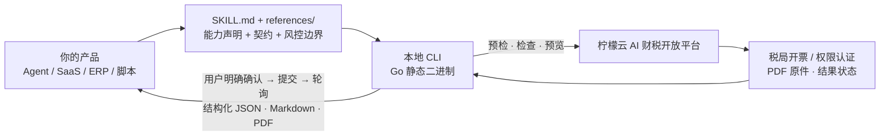

# invoice-issue · 柠檬云全场景开票 Skill

> **给开发者**：把「多源开票资料解析 → 自动赋码 → 票面校验 → 预览确认 → 正式开票 → 权限认证 → PDF 交付与台账」这条链路，免费接进你自己的 AI Agent、SaaS 或 ERP。开票是有真实外部副作用的动作，这个仓库最值钱的不是"发一个 HTTP 请求"，而是**一整套防止开错票、重复开票、跳过人工确认的硬门禁**。

**Open-source Chinese invoice issuance Skill for AI agents** — MIT licensed · text / voice / ERP batch / unstructured document input · auto tax coding · mandatory preview confirmation · 5-minute duplicate guard · structured JSON output · free API key · Go static binary.

     

[开放平台首页](https://www.nmy.cn) · [Skill 列表](https://www.nmy.cn/skills) · [开放 API 文档](https://opendocs.nmy.cn) · [总集合仓库 lemon_skill](https://github.com/ningmengyun12366/lemon_skill) · [能力矩阵](#这个仓库背后是一整套免费开放能力) · [30 秒跑起来](#30-秒跑起来)

---

## TL;DR：这个仓库解决什么问题

开票和"查一张发票"完全不同：**一旦提交就产生真实的税务凭证**。做开票相关的 AI 产品，难点从来不是生成一段 JSON，而是别让它开错：

| 你要做的事      | 自己从零做                                        | 用 `invoice-issue`                                                                                             |
| ---------- | -------------------------------------------- | ------------------------------------------------------------------------------------------------------------- |
| 多源资料变成开票字段 | 自己写文字 / 语音 / 订单 Excel / 合同 PDF / 图片解析，再逐字段映射 | 按 [`references/field-mapping.md`](./invoice-issue/references/field-mapping.md) 统一映射为 `invoices[]`，识别不稳时先确认再继续 |
| 税收分类编码赋码   | 维护上千条商品编码与匹配规则，且每年更新                         | 内置智能赋码（`tax_coding_recommendation`）                                                                           |
| 票种与购方合规    | 自己判断票种、查购方税号                                 | 每张必须显式 `invoiceType`；企业购方缺税号时强制 `issue-search-enterprise` 查询，多候选必须让用户选，不得默认第一条                                |
| 防误开、防重复    | 靠人眼核对，或用 prompt 叮嘱模型"小心点"                    | **预览确认硬门禁**（必须完整展示预览并收到明确 `确认开票`）+ **5 分钟同内容指纹阻断**                                                            |
| 开票权限认证     | 自己对接电子税局登录、扫码、人脸与会话保活                        | `issue-auth-workflow` 处理认证与状态续查，只有认证通过才回到开票流程                                                                 |
| 结果交付       | 手工下载 PDF、发给客户、再登记台账                          | 返回税局官方发票 PDF 原件，支持一键交付收票方与标准化发票台账                                                                             |
| 接进已有系统     | 自己设计接口、鉴权、错误码                                | stdout 纯 JSON、失败也是 JSON，诊断走 stderr，可直接管道接进服务                                                                  |

**它是一个 Skill，也是一个 CLI。** 既可以挂到遵循 `SKILL.md` 规范的 Agent 上，也可以当作命令行工具嵌进 ERP 销售模块、电商后台、开票系统或你自己的 SaaS。CLI 二进制名为 `invoice-assistant`（各平台带后缀，见安装文档）。

---

## 这个仓库开源了什么

MIT 协议，可商用、可修改、可二次分发。仓库里是**完整可读的 Skill 层实现**，不是只放一个安装包：

| 路径                                                                                                             | 内容                                                                                                                                                                                                                                                                    | 你能拿它做什么                                  |
| -------------------------------------------------------------------------------------------------------------- | --------------------------------------------------------------------------------------------------------------------------------------------------------------------------------------------------------------------------------------------------------------------- | ---------------------------------------- |
| [`invoice-issue/SKILL.md`](./invoice-issue/SKILL.md)                                                           | 给模型看的能力定义与执行规范：新任务 / 继续任务判定、检查-预览-确认-提交链路、预览确认硬门禁、链接裸文本硬规则、标准 `invoices[]` 输入、安全规则、参考路由                                                                                                                                                                               | 读懂一个"会写库的 AI 动作"该怎么被约束；照着改成你自己的高风险 Skill |
| [`invoice-issue/references/`](./invoice-issue/references/)                                                     | 14 份契约文档：`workflow.md` 流程、`field-mapping.md` 字段映射、`api-contracts.md` CLI 契约、`risk-boundaries.md` 风控边界、`error-handling.md` 异常处理、`amount-calculation.md` 金额补算矩阵、`issue.md` 字段表等                                                                                         | 对齐真实接口字段与错误码，减少对接返工；也是一份现成的高风险流程设计范本     |
| [`invoice-issue/README.md`](./invoice-issue/README.md)                                                         | 发布包内的使用者说明：控制台「企业税务信息设置」与 API Key（绑定「发票开具」权限及企业）                                                                                                                                                                                                                      | 直接复用为你的产品文档                              |
| [`invoice-issue/invoice-issue-install.md`](./invoice-issue/invoice-issue-install.md)                           | 安装 / 更新 / 回滚流程、多平台二进制下载约定、发布包目录结构                                                                                                                                                                                                                                     | 参考它的自动更新与失败回滚设计                          |
| [`go-script/lib/invoice-assistant-go/issue/`](./go-script/lib/invoice-assistant-go/issue/)                     | Go 实现：`issue_duplicate_guard.go` 防重复、`issue_submission_guard.go` 提交门禁、`issue_content_fingerprint.go` 内容指纹、`tax_coding_recommendation.go` 智能赋码、`auth_qrcode*.go` 权限认证、`issue_status.go` / `issue_polling_hooks.go` 结果轮询、`task_lock*.go` 任务锁、`dictionary_preview.go` 预览 | 看懂并复用门禁、幂等与状态机设计                         |
| [`go-script/build.js`](./go-script/build.js) · `go-script/config/prod.json` · [`package.json`](./package.json) | 生产打包脚本、接口端点注入、`npm run build`                                                                                                                                                                                                                                         | 从源码构建你自己的发布包                             |
| [`SECURITY.md`](./SECURITY.md)                                                                                 | 私下报告安全问题的通道                                                                                                                                                                                                                                                           | —                                        |
| [`THIRD_PARTY_NOTICES.md`](./THIRD_PARTY_NOTICES.md) · [`LICENSE`](./LICENSE)                                  | 第三方组件与字体许可、MIT 许可                                                                                                                                                                                                                                                     | —                                        |

**边界说清楚**：本仓库开源的是 Skill 定义、契约文档与 Go 客户端实现；数电发票开具、税局登录与权限认证等服务端能力由[柠檬云 AI 财税能力开放平台](https://www.nmy.cn)提供，运行时需要一个绑定了「发票开具」权限及对应企业的 API Key。也正因为开票会产生真实凭证，**把不可绕过的确认与防重复逻辑放在开源客户端里**，比只开放一个"一键开票"接口更值得参考：预检、检查、预览、明确确认、权限认证、防重复、结果轮询，任何一步都不能跳。

凭据边界同样明确：工作区只保存 API Key 与 `workspace`，**不保存「当前企业」、`uscc` 或 `companyInfo`**；API Key 通过 `workspace-config-writer` 或文档给出的安全配置路径在本地写入，不得要求用户在对话中公开密钥；`runtime-config.json` 只能包含接口基础地址、能力码等非密信息。

运行环境与发布约定：Node.js 20+ / Go 1.24+ 用于本地构建；发布物生成在 `dist/Skills/invoice-issue/`；运行时 ZIP 不含 `bin/**` 二进制，也不含 `scripts/**` 安装脚本，安装时按当前平台单独下载 `invoice-assistant_<platform>` 二进制。ZIP 内含 `references/*.md`、`runtime-config.json`、`assets/common_dict.json`、`assets/invoice_preview.html`。支持 Windows amd64、Linux amd64/arm64、macOS amd64/arm64。

---

## 这个仓库背后是一整套免费开放能力

`invoice-issue` 是[柠檬云 AI 财税能力开放平台](https://www.nmy.cn)开源出来的其中一个 Skill。开发者免费注册后，可以按需要单独接入某一项能力，也可以把整条财税链路补齐到自己的产品里——**不用换系统、不用让用户跳到另一个平台**。

| 能力                               | 状态         | 典型集成场景                     | 源码 / 入口                                                                                                              |
| -------------------------------- | ---------- | -------------------------- | -------------------------------------------------------------------------------------------------------------------- |
| **全场景开票**（本仓库）                   | 已上线        | 电商、ERP、CRM 的自动开票模块         | [`invoice-issue-skill`](https://github.com/ningmengyun12366/invoice-issue-skill)                                     |
| 发票查验查重及台账                        | 已上线        | 报销系统、差旅平台、财务共享中心           | [`batch-invoice-verify-skill`](https://github.com/ningmengyun12366/batch-invoice-verify-skill)                       |
| 发票整理、查验及报销助手                     | 已上线        | 员工报销、票据中台、邮箱收票自动化          | [`invoice-reimbursement-assistant-skill`](https://github.com/ningmengyun12366/invoice-reimbursement-assistant-skill) |
| 企业发票核验与征信分析                      | 已上线        | 供应链风控、供应商准入、贷前尽调           | [`invoice-verify-analysis-skill`](https://github.com/ningmengyun12366/invoice-verify-analysis-skill)                 |
| 发票获取及风险分析                        | 已上线        | 代账机构批量体检、财税健康度看板           | [`invoice-fetch-and-risk-analysis-skill`](https://github.com/ningmengyun12366/invoice-fetch-and-risk-analysis-skill) |
| 企业税务风险分析                         | 已上线        | 财税顾问交付、税务自查、尽调报告           | [`tax-analysis-skill`](https://github.com/ningmengyun12366/tax-analysis-skill)                                       |
| AI 财税专家咨询 · 财税知识库                | 已上线        | 财税问答机器人、Agent 的政策依据兜底、合规留痕 | [`tax-knowledge-skill`](https://github.com/ningmengyun12366/tax-knowledge-skill)                                     |
| 财务软件账套连接器                        | 已上线        | 在 AI 里直接查账、出表、做经营分析        | [Skill 列表](https://www.nmy.cn/skills)                                                                                |
| 资金全流程管理（银行流水 / 回单 / 自动对账 / 资金报表） | 官方路线图，即将上线 | 资金看板、现金流分析                 | [开放平台](https://www.nmy.cn)                                                                                           |

> 想要一次性拿到全部 Skill 的源码与能力矩阵，看总集合仓库 [`lemon_skill`](https://github.com/ningmengyun12366/lemon_skill)。每个子仓库可独立使用，不需要整套引入。

### 需要做系统集成？还有标准化 REST API

除了 Skill，开放平台还把税局侧的高频操作开放成了 REST 接口，文档在 **[opendocs.nmy.cn](https://opendocs.nmy.cn)**：

- **登录业务**：企业登录 API、代理企业登录 API（QYYW / ZRRYW / DLYW 三类登录，异步任务 + 验证码流程）
- **发票同步**：发票数据同步、勾选数据同步、发票附件下载（PDF / OFD 版式文件）
- **发票查验**：与全国增值税查验平台口径一致的单张查验，同步返回查验结论及全票面结构化数据
- **发票开具**：蓝字数电发票开具、红字发票全流程（确认单同步 / 创建 / 确认 / 拒绝 / 撤销）
- **开票基础能力**：基础信息与授信查询、客户与商品信息维护、人脸认证、税率与票种字典

两种接入方式的凭据是不同的，别混用：

| 接入方式            | 凭据                                       | 适合谁                        |
| --------------- | ---------------------------------------- | -------------------------- |
| 调用 Skill / CLI  | 控制台创建的 **API Key**，创建时绑定「发票开具」权限及需开票的企业  | 个人开发者、AI Agent、SaaS 产品快速验证 |
| 直连开放平台 REST API | 接入申请后由平台提供 **appId / appSecret** 与正式接口地址 | ISV、ERP/OA 厂商做产品级集成        |

注册即享**月度免费调用额度，月月重置**，具体额度、有效期与计费规则以开放平台控制台显示为准；产品级用量、商用授权与更高配额可在控制台查看或联系平台客服。

---

## 30 秒跑起来

### 1. 配好企业信息与免费 API Key

到 [柠檬云 AI 财税能力开放平台](https://www.nmy.cn) 注册登录 → 控制台 → **企业税务信息设置**，新增并维护需开票企业的税务信息 → **API Key 管理** → 新建 Key，**绑定「发票开具」权限及需开票的企业**。API Key 通过 `workspace-config-writer` 或发布包 README 给出的安全配置路径在本地写入，不要在对话中公开密钥。

> 工作区只保存 API Key 与 `workspace`；不保存「当前企业」、`uscc` 或 `companyInfo`。`runtime-config.json` 与源码、日志、输出文件都不得写入真实密钥。

### 2. 安装 Skill

**方式 A · 交给 Agent 自动装**：在 [Skill 列表](https://www.nmy.cn/skills) 找到「全场景开票」，复制安装链接，粘贴到你的 AI 客户端对话框即可。

**方式 B · 当作 CLI 直接用**（推荐给产品集成）：按 [`invoice-issue-install.md`](./invoice-issue/invoice-issue-install.md) 安装发布包与当前平台 `invoice-assistant_<platform>` 二进制；也可以从本仓库源码自行构建。

### 3. 调一次

```bash
# 1) 业务执行前预检（可追加 --enterprise-name）
invoice-assistant task-preflight-check --pretty

# 2) 企业购方缺税号时，先查候选（多候选必须让用户选，不得默认第一条）
invoice-assistant issue-search-enterprise --query "示例科技有限公司" --pretty

# 3) 构造 input.json 后创建任务、校验字段并生成预览 Markdown
invoice-assistant issue-batch-invoice-info-check --input ./input.json --pretty

# 4) 完整展示预览、收到用户明确的「确认开票」之后，才允许正式提交
invoice-assistant issue-from-output --confirm-preview --pretty

# 5) 需要开票权限认证时（扫码后 --action verify 续查）
invoice-assistant issue-auth-workflow --action start --pretty
```

标准 `invoices[]` 输入（即使只开一张也必须是数组中的一个元素）：

```json
{
  "uscc": "销售方税号",
  "invoices": [
    {
      "invoiceType": "普通发票",
      "purchaserInfo": { "name": "购买方名称", "isNaturePerson": false },
      "details": [
        { "projectName": "商品或服务名称", "taxInclusiveAmount": 100 }
      ]
    }
  ]
}
```

字段要点：根节点必须是带 `invoices[]` 的对象；顶层 `uscc` 必须由本次用户明确提供，不得复用上次企业；每张必须显式 `invoiceType`，小规模纳税人也不得默认补普通发票；金额默认按含税口径，提供单价但未提供数量时默认 `quantity=1`，税额为 0 是合法结果。完整字段表见 [`references/issue.md`](./invoice-issue/references/issue.md)。

Windows PowerShell 里首次调用本地二进制前，把 UTF-8 初始化和命令放在同一次终端调用中：

```powershell
$Utf8NoBom = New-Object System.Text.UTF8Encoding($false)
[Console]::InputEncoding = $Utf8NoBom
[Console]::OutputEncoding = $Utf8NoBom
$OutputEncoding = $Utf8NoBom
.\bin\windows-amd64\invoice-assistant_windows_amd64.exe --help
```

提交后返回税局官方发票 PDF 原件、交付链接与标准化发票台账；仍在处理中时用同一任务续查状态。业务命令 stdout 是可解析 JSON，失败时 stdout 仍返回 JSON 错误对象，诊断与进度一律走 stderr——**可以直接用管道接进你自己的服务**。

**两条不能省的展示规则**：预检、预览、认证与结果命令生成的 Markdown 必须原样渲染，不得摘要、改写、脱敏或重排；其中所有 HTTP/HTTPS 链接与本地路径必须按原文**裸文本逐行展示**，不得包装成 `[点击查看](...)`、`<a href>` 或"点击下载"这类短文本。

---

## 它是怎么工作的



几个为了让"高风险动作"可控而做的取舍：

- **薄 Agent、厚 CLI**：预检、字段校验、自动赋码、内容指纹、提交门禁、权限认证、状态轮询收敛在 CLI 里，模型只负责把自然语言或文件整理成 `invoices[]`，以及按规则原样展示预览。换个模型版本不会把风控链路跑断。
- **预览确认是硬门禁**：必须先完整渲染当前预览并提示用户回复 `确认开票`，才允许携带 `--confirm-preview`；生成预览的同一轮、尚未展示完整预览、或用户只是模糊同意时，一律禁止提交。不得手工修改任务状态里的 `invoice_preview_confirmed`，也不得自行构造正式开票 payload 或 HTTP 请求。
- **5 分钟防重复开票**：按规范化后的发票内容指纹判断，同内容任务在 5 分钟内无论处理中、已提交、状态未知或已完成，都阻断新的正式提交。
- **新任务 / 继续任务严格区分**：用户重新提供或修改任一开票要素即视为新任务，必须重新整理 input JSON、重新检查、重新生成预览；只有明确承接同一任务（如 `确认开票`、查看刚才结果）才复用任务状态。无法确定时按新任务处理。
- **链接与 Markdown 原样输出**：所有链接与本地路径裸文本逐行展示，不做任何编码、脱敏、截断、改参或包装；正常输出中不得暴露 task JSON 路径、payload、token、cookie、API Key、税局密码、验证码、二维码截图或人脸认证材料。
- **权限认证有边界**：只有返回结果同时具备 `qrcode_markdown_path`、`qrcode_list`、`qrcode_image_paths` 时才能读取认证 Markdown；不得把"手动登录网页入口"解释成二维码或权限认证入口，不得输出 `MEDIA:`、Base64、`rzid` 等内部内容。
- **静态二进制**：Go 单文件编译，不依赖 Python / Node 运行时，容器和沙箱里都干净。
- **凭据只在运行时**：API Key 通过本地安全配置或命令参数传入，不落源码、不落发布包、不落日志；生产接口端点在构建期由 `go-script/config/prod.json` 注入。

### 兼容哪些 AI 客户端

同一套 `SKILL.md` 规范，无需改动即可用于 [WorkBuddy](https://copilot.tencent.com/work/)、[豆包工作](https://www.doubao.com/work)、[千问办公](https://qwenwork.cn/)、AutoClaw（智谱）、ArkClaw（字节跳动）、MaxClaw（MiniMax）、[OpenClaw](https://openclaw.ai/) 等已适配平台。只要你的 Agent 会读 `SKILL.md` 的 `name` / `description` 决定是否调用，就能挂上；不通过 Agent、纯 CLI 或 REST API 集成也完全可以。

---

## 给 AI 博主 / 内容创作者：可直接引用的事实

做评测、写选型对比或录教程时，下面这几条可以直接用，都附了可复现的验证方式：

**一句话速览（可复制）**

> 柠檬云把「全场景开票」做成了 MIT 开源的 Agent Skill：文字 / 语音、ERP 订单 Excel、合同图片等非结构化资料都能解析成开票字段并自动赋码，但真正值得看的是它的风控——必须完整展示预览、收到明确的「确认开票」才允许提交，5 分钟内同内容重复开票会被硬阻断，所有链接与结果 Markdown 必须原样裸文本输出。同平台共开源了 7 个财税 Skill 仓库，覆盖查验、报销、征信分析、税务风险与政策知识库。

**可核验事实**

| 事实                                                                     | 怎么验证                                                                                                                                               |
| ---------------------------------------------------------------------- | -------------------------------------------------------------------------------------------------------------------------------------------------- |
| Skill 层以 MIT 协议开源，允许商用与二次分发                                            | 根目录 [`LICENSE`](./LICENSE)                                                                                                                         |
| 预览确认硬门禁：`--confirm-preview` 只能映射用户对当前已展示预览的明确确认                        | [`SKILL.md` 的「安全规则」与「快速开始」](./invoice-issue/SKILL.md)                                                                                              |
| 5 分钟内同内容任务阻断新的正式提交                                                     | [`SKILL.md` 的「安全规则」](./invoice-issue/SKILL.md) · [`issue_duplicate_guard.go`](./go-script/lib/invoice-assistant-go/issue/issue_duplicate_guard.go) |
| 所有 HTTP/HTTPS 链接与本地路径必须裸文本逐行展示，不得包装成 Markdown/HTML 短链接                 | [`SKILL.md` 的「链接展示硬规则」](./invoice-issue/SKILL.md)                                                                                                  |
| 每张发票必须显式 `invoiceType`；企业购方缺税号须先 `issue-search-enterprise` 查询且不得默认取第一条 | [`SKILL.md` 的「标准 invoices[] 输入」](./invoice-issue/SKILL.md)                                                                                         |
| 工作区只保存 API Key 与 workspace，不保存当前企业 / uscc / companyInfo；不得要求用户公开密钥     | [`SKILL.md` 的「快速开始」](./invoice-issue/SKILL.md) · [`invoice-issue-install.md`](./invoice-issue/invoice-issue-install.md)                            |
| 14 份接口契约与风控文档完整公开                                                      | [`invoice-issue/references/`](./invoice-issue/references/)                                                                                         |
| 业务命令 stdout 纯 JSON、失败也是 JSON，诊断走 stderr                                | [`invoice-issue-install.md`](./invoice-issue/invoice-issue-install.md)                                                                             |
| 平台已上线 7 个开源 Skill 仓库 + 账套连接器，资金能力在路线图中                                 | [GitHub 组织](https://github.com/ningmengyun12366) · [Skill 列表](https://www.nmy.cn/skills)                                                           |
| 税局侧高频操作另有标准化 REST API 文档                                               | [opendocs.nmy.cn](https://opendocs.nmy.cn)                                                                                                         |

**30 秒可复现的 demo**：注册 → 控制台维护企业税务信息并创建绑定「发票开具」的 API Key → 本地写入配置 → 跑 `task-preflight-check` → 用一句「给 X 公司开一张 100 元的服务费普票」生成 `input.json` → 跑 `issue-batch-invoice-info-check` 看校验结果与预览 Markdown → **故意不确认**，观察 `issue-from-output --confirm-preview` 不被允许；再回复「确认开票」完成提交，并立即用相同内容再试一次，观察 5 分钟防重复阻断。

**几个容易写错的地方，先说清楚**：

- 它**不是离线工具**，也**不是"发个 HTTP 请求就开票"**：运行时需要联网调用开放平台开票接口与税局认证；正式开票必须走已检查、已展示预览、已确认的 `issue-from-output`，不得自行构造请求；
- 开源范围是 **Skill 定义、契约文档与客户端实现**，服务端开票接口与税局通道不在仓库内；
- **预览确认与防重复是硬门禁**，不是 prompt 建议；不要写成"AI 会自动判断是否可以开票"；
- 官网 Skill 详情页与仓库源码 / 安装文档的版本号存在发布节奏差异，写稿时请以**官网详情页与安装文档**为准，不要照抄源码里的 version；
- **资金全流程管理**官方标注为"即将上线"，请勿写成已可用；
- Skill 用的 **API Key** 与 ISV 直连 REST API 用的 **appId / appSecret** 是两套凭据；
- 免费额度按月重置，官方公开过开票额度数字，但具体数值以控制台实时显示为准，不建议在稿子里写死。

欢迎实测、评测与转载。涉及能力状态、版本、额度与计费的表述，请以开放平台控制台与本文档为准。需要接入支持可走开放平台控制台，或服务热线 400-004-0696。

---

## FAQ

**Q：没用 Agent，只有后端服务，能用吗？**
能。CLI 是独立二进制，stdout 纯 JSON；也可以直接走 [开放 API 文档](https://opendocs.nmy.cn) 里的 REST 接口做系统集成。但预览确认、防重复这类门禁建议保留，不要为了"自动化"绕过去。

**Q：支持哪些开票资料？**
文字 / 语音单张开票、ERP 或电商订单 Excel 批量开票、合同 PDF / 图片 / 不规则表格等非结构化资料开票。来自文件的内容必须先提取成明确的开票字段再写入 `invoices[]`；识别不稳或核心字段冲突时先确认再继续。

**Q：会不会在我没确认时就把票开出去？**
不会。预览确认是硬门禁：必须完整渲染当前预览并收到明确的 `确认开票`，才允许携带 `--confirm-preview` 提交；模糊同意、同一轮生成预览但未展示、或复用历史预览都不算。

**Q：重复点两次会开两张票吗？**
不会。按规范化后的发票内容指纹判断，同内容任务在 5 分钟内无论处理中、已提交、状态未知或已完成，都会阻断新的正式提交。

**Q：需要登录税局 / 扫码认证吗？**
按实际返回结果决定。需要时由 `issue-auth-workflow` 处理认证与状态续查，只有认证通过后才回到开票流程；命令提示登录问题时，安全登录地址一律称为"手动登录网页入口"，不得解释成二维码或权限认证入口。

**Q：API Key 要贴在对话里给我吗？**
不要。按发布包 README 通过 `workspace-config-writer` 或安全配置路径在本地写入；工作区只保存 API Key 与 `workspace`，不保存当前企业、`uscc` 或 `companyInfo`。

**Q：开源范围包含开票接口和税局通道吗？**
不包含。MIT 覆盖本仓库自有代码、文档与资源；开票服务端、税局登录与认证能力由开放平台提供，需要绑定了「发票开具」权限及企业的 API Key。

**Q：能商用吗？**
MIT 允许商用与二次分发。具体调用额度、产品级用量与商用授权以开放平台控制台与平台说明为准。

**Q：支持哪些平台和 Agent？**
Windows amd64、Linux amd64/arm64、macOS amd64/arm64；遵循 `SKILL.md` 规范的 Agent 客户端均可挂载，已适配的主流平台见上文。

**Q：报告安全问题走哪个渠道？**
请勿开公开 Issue，按 [`SECURITY.md`](./SECURITY.md) 使用 Private vulnerability reporting 私下提交；报告里不要附 API Key、税局凭据、真实企业数据或未脱敏日志。

---

## 自己构建

```bash
npm ci
npm run build
# 等价于：node go-script/build.js --env prod invoice-issue
```

生产发布物落在 `dist/Skills/invoice-issue/`。ZIP 不含 `bin/**` 二进制与 `scripts/**` 安装脚本，安装时按 [`invoice-issue-install.md`](./invoice-issue/invoice-issue-install.md) 的下载表只拉取当前平台对应的一个 `invoice-assistant_<platform>` 二进制。

## 配置与数据安全

- API 凭据由使用者在本地工作区配置，不应写入源码、文档、发布包、日志或提交记录。
- `runtime-config.json` 只能包含接口基础地址、能力码等非密信息；API Key、token、密码、签名 URL 与本机绝对路径都不得写入。
- 生产接口端点通过 `go-script/config/prod.json` 在构建期注入发布包。
- 正常用户输出中不得暴露内部 task JSON 路径、正式 payload、token、cookie、API Key、税局密码、短信验证码、二维码截图或人脸认证材料。
- 发票属于敏感业务数据，请按你所在场景的合规要求进行存储与留痕；第三方组件与字体许可见 [`THIRD_PARTY_NOTICES.md`](./THIRD_PARTY_NOTICES.md)。

## 反馈与贡献

集成问题、适配需求与功能建议，欢迎通过仓库 Issue 反馈；若你写了文章、录了教程或基于本仓库做了二次开发，也欢迎贴链接，我们会收录并协助传播。安全问题的私下报告渠道见 [`SECURITY.md`](./SECURITY.md)。

## 许可证

本项目自有代码、文档与资源文件采用 [MIT License](./LICENSE)，允许商用与二次分发。

---

## English / 搜索索引

`invoice-issue` is an MIT-licensed, open-source Agent Skill for **Chinese invoice issuance (fapiao / fully digitalized e-invoice)**. It turns text, voice, ERP order spreadsheets and unstructured documents (contracts, images, irregular tables) into a standardized `invoices[]` payload with automatic tax classification coding, validates header and amount fields, generates a preview, and only submits after an explicit user confirmation. A 5-minute content-fingerprint guard blocks duplicate submissions, an authorization workflow handles tax bureau authentication, and all links and generated Markdown must be rendered verbatim. It ships 14 reference contracts covering workflow, field mapping, API contracts, risk boundaries and error handling. It is one of seven Skills open-sourced by the [Ningmengyun AI Finance & Tax Open Platform](https://www.nmy.cn), which also provides standardized REST APIs for invoice issuance, verification, synchronization and tax login. A free API key with a monthly quota is available after registration.

**Search terms / 检索关键词**：数电发票开具 · 全场景开票 · 批量开票 · 语音开票 · ERP 订单开票 · 自动赋码 · 税收分类编码 · 发票预览确认 · 防重复开票 · 开票权限认证 · 电子税局登录 · 发票 PDF 原件 · 发票台账 · 财税 AI · Agent Skill · SKILL.md · MCP tool-use · human-in-the-loop · idempotency guard · 开源财税 Skill · Go CLI structured JSON · invoice issuance API China · fapiao · fully digitalized e-invoice · e-invoice API · duplicate invoice prevention · tax coding automation · OpenClaw / WorkBuddy skill

---

**给你的 AI 产品补一块「中国财税」的专业能力，从这里开始。**

[免费获取 API Key](https://www.nmy.cn) · [浏览全部 Skill](https://www.nmy.cn/skills) · [开放 API 文档](https://opendocs.nmy.cn) · [总集合仓库 lemon_skill](https://github.com/ningmengyun12366/lemon_skill)

<sub>本仓库由深圳易财信息技术有限公司（柠檬云）维护。
